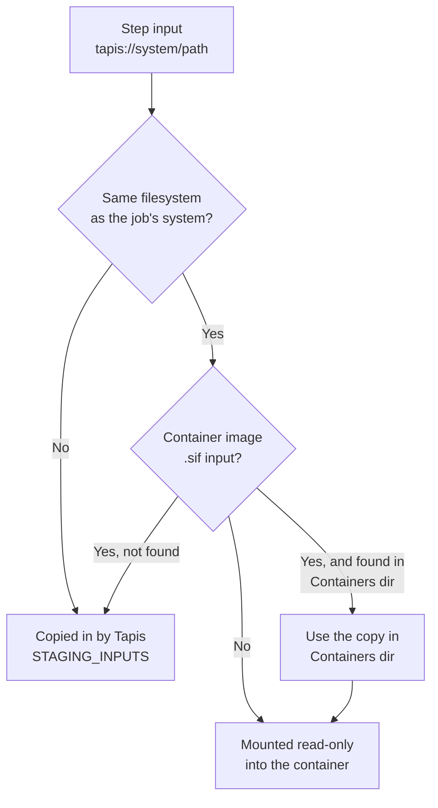

---
tags:
  - CI4AI
  - Digital-Agriculture
  - Software
title: "No-Code Workflow Studio: Explanation"
sidebar_label: "Explanation"
pagination_label: "Explanation"
description: "Explanation for No-Code Workflow Studio. A browser-based workflow builder for the full ML lifecycle: wire up a pipeline in a drag-and-drop canvas — data…"
---
# Explanation

## Templates, versions, and runs

A **template** is a named graph: nodes (a step type + its configuration) and
edges (output port → input port). Saving an existing template writes a **new
version** instead of mutating it, and a run always points at one specific
version. Launching with unsaved edits still records the exact graph behind the
scenes — as a version if you asked for one, otherwise as a hidden draft — so
every run stays reproducible and none of them silently changes meaning when you
edit the template later.

A **run** additionally freezes its launch configuration (exec systems, queues,
account, directories, and the resolved node/edge snapshot). That frozen config is
what the engine reads when rendering each step's job, and what the run page's ⚙
drawer shows you afterwards.

## Ports and type compatibility

Every port has a data type — `image_dir`, `pytorch_model`, `json_results`,
`csv_data`, `shapefile`, `geopackage`, `heatmap_image`, and others. An edge is
allowed when:

1. the types are identical, or
2. the source type is a **subtype** of the target type (e.g. `image_dir` into a
   port accepting `file_collection`), or
3. the target type declares a **coercion** from the source type.

This is checked in the browser as you draw the connection, and again on the
server when the template is saved. It is what makes a graph structurally valid
before a single job is submitted.

## The step catalogue

| Stage | Steps |
| --- | --- |
| **Data Sources** | Image Directory, YOLO Labels Directory, CSV Dataset, JSON File, Pretrained Model, Shapefile, GeoPackage |
| **Data Collection** | Extract Frames |
| **Data Pre-processing** | Preprocessing, Image Crop, Image pre-processing studio |
| **Training** | Model Training, Publish to PATRA |
| **Inference** | Model Inference, YOLO Inference, Object Detection, Image Classifier, Zero-Shot Annotation, Few-Shot Annotation, Smart Labeler |
| **Visualization** | Visualization, Heatmap Generation, Class Histogram, Geospatial Map Viewer |
| **Post-processing** | Geospatial (GeoPackage), Custom Shapefile, Flight Plan Generator, Mission Export Adapter, Annotation Format Adapter |
| **Data Sinks** | Write Image Directory, Write Model, Write Results (JSON), Write CSV, Write Shapefile, Write Heatmap |

Sources have outputs but no inputs; sinks have inputs but no outputs. Empty
stages still appear in the palette so the pipeline's shape stays visible.

## Design-time steps vs job steps

Most steps submit a Tapis job. A few — Smart Labeler, the Geospatial Map viewer,
the Annotation Format Adapter's editor — are **design-time only**: they run
entirely in the browser against Tapis files, produce their output there and then,
and never queue anything. Those nodes have no 🖥 Run Configuration icon (there's
no compute to request), and on a run page clicking one opens its panel rather
than a log view.

## How inputs reach a job

Tapis normally **copies** every input into a job's folder before the job starts.
For a large image folder that copy can take longer than the job itself, even when
the data already sits on the machine the job runs on. So the Studio only copies
when it has to:

- **Same filesystem.** An input on the job's own system is mounted read-only
  into the container (`--bind host-path:container-path:ro`). The OSC systems
  `pitzer-tapis`, `cardinal-tapis` and `ascend-tapis` share `/fs/ess` and
  `/fs/scratch`, so data on any of them is mounted on the others too.
- **Different filesystem.** Data on another site, or behind an `https://` link,
  is still copied in as before.
- **Container images.** Training, inference and preprocessing ship their
  container as a `.sif` input. If your **Containers dir** has a file with the same
  name (case, `-` and `_` ignored), that copy is mounted instead of downloading
  the image every run.
- **When in doubt, copy.** If the Studio can't confirm a mount will work (a
  Docker-based app, a missing source, a Tapis error), the input is copied as
  before. Mounting never makes a job fail.

Mounting works with Apptainer/Singularity apps only. A step author can keep an
input copied by adding `"bind": false` to it in the step's `step.json`, for a tool
that writes into its own input folder.

**Keep outputs with a sink.** Jobs no longer archive their outputs to a second
location. A step's outputs stay in its job folder under your work dir, where the
next step reads them. Scratch space is purged on a schedule, so **wire any output
you want to keep into a sink node** (e.g. **💾 Write Results (JSON)**). An app
whose own Tapis definition sets an archive system still archives there.

## From node to Tapis job

When a run executes, the engine walks the DAG in dependency order. For each node
it resolves the node's inputs from its incoming edges (binding the upstream
step's output URIs to this step's input ports), merges the node's frozen
configuration, resolves any secret references, renders the step type's Tapis job
template by substituting `${…}` placeholders, mounts the inputs it can (see
[How inputs reach a job](#how-inputs-reach-a-job)), and submits it to
`POST /v3/jobs/submit`. It then polls the job's status until it finishes,
recording each transition against the step — which is exactly what the canvas is
showing you live. Per-step state lives in `pipeline_run` / `run_step`; if no
Tapis credential is configured the engine falls back to a mock client so the
system still runs end-to-end locally.

Full detail, including credentials and the provisioning a real run requires, is
in [backend/INTEGRATION.md](https://github.com/ICICLE-ai/workflow-orchestrator/blob/main/backend/INTEGRATION.md).
